# Activit-Pratique-N-1---Injection-des-d-pendances

## Introduction
Ce projet consiste à mettre en pratique le concept d'injection de dépendances en Java, un principe qui permet de réduire le couplage entre les classes et de rendre le code plus flexible et maintenable.
L'objectif est d'implémenter et de comparer différentes méthodes d'injection de dépendances : l'injection statique, l'injection dynamique par réflexion, ainsi que l'utilisation du framework Spring avec une configuration XML et des annotations.
Ce travail pratique permet de comprendre les avantages de chaque approche et de découvrir comment l'injection de dépendances facilite le développement et la maintenance des applications Java.

1. v Création de l'interface IDao avec une méthode getData

2. Création d'une implémentation de cette interface
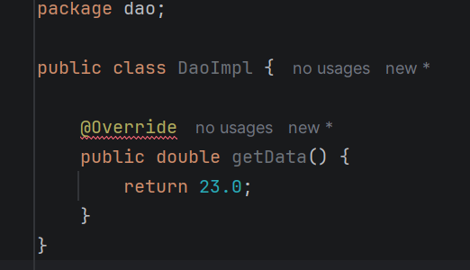

3. Création de l'interface IMetier avec une méthode calcul
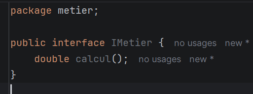

4. Création d'une implémentation de cette interface en utilisant le couplage faible
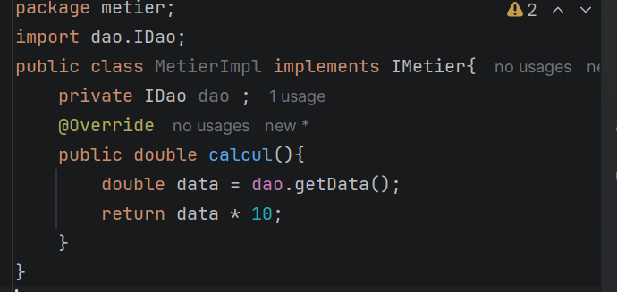

5. l'injection des dépendances :
   a.Par instanciation statique

6. création de la class presentation pour la création de nouveaux objets 
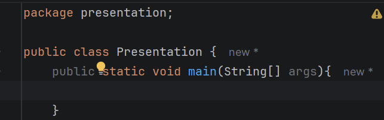

7. instanciation statique (création des objets dans presentation)
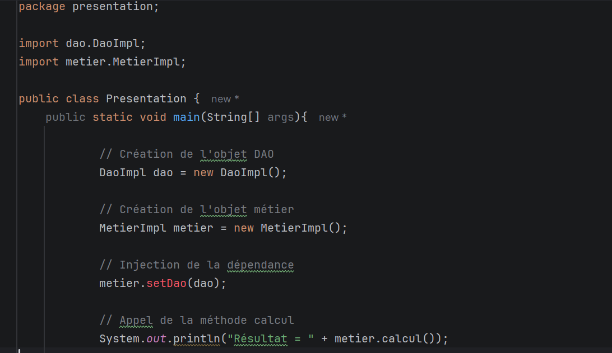

8. ajout d'un setter dans MetierImpl pour accéder a presentation
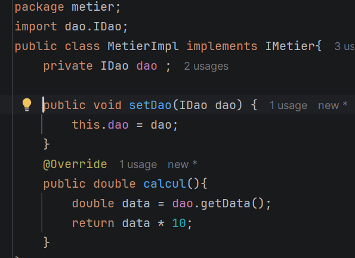

9. test de la metier.calcul()
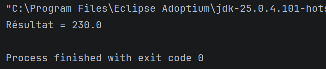

10. création du directory ressources et du dossier conf.txt
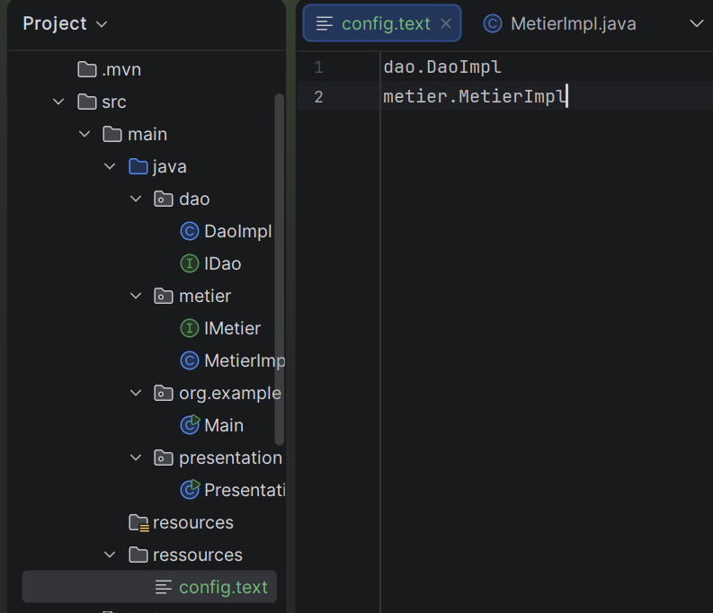

11. modification de MetierImpl avec un setter, pour injecter DAO
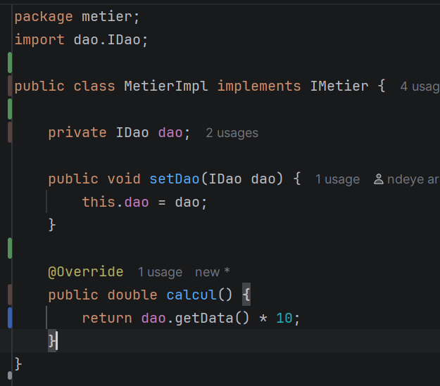

12. presentation2 pour l'instanciation dynamique
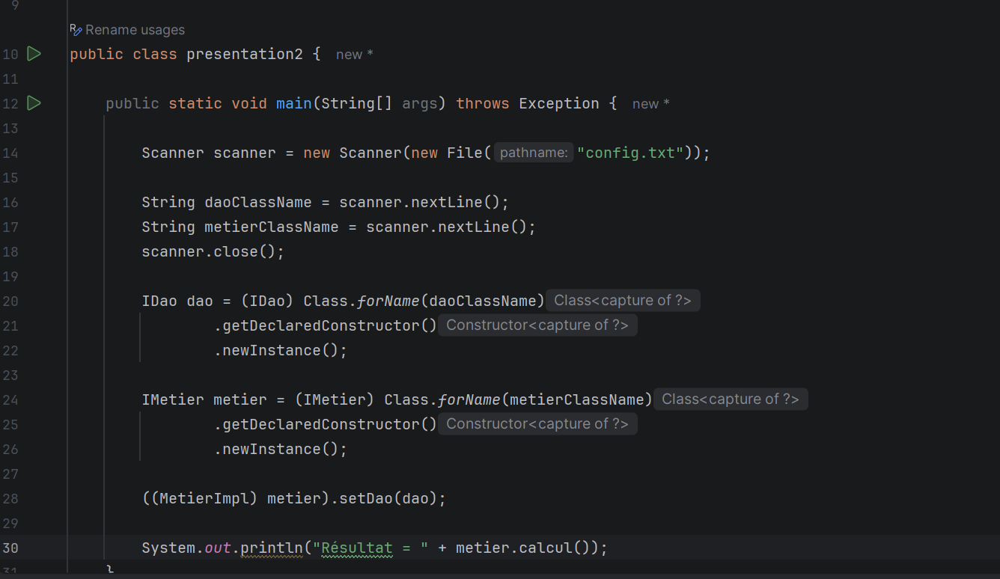

13. modification de conf.txt

14. test du programme presentation2
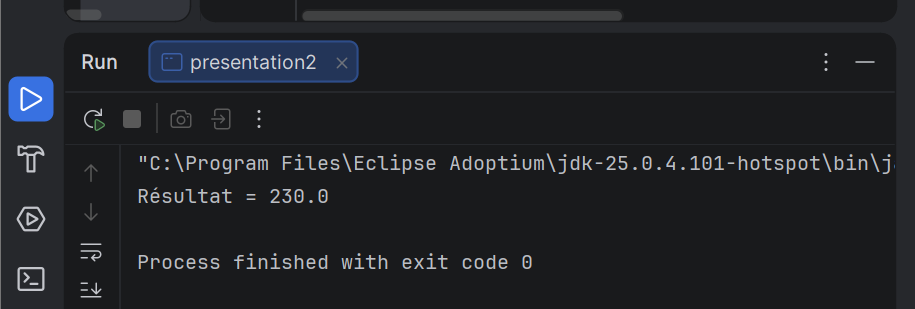

15. ajout des dépendances dans pom.xml
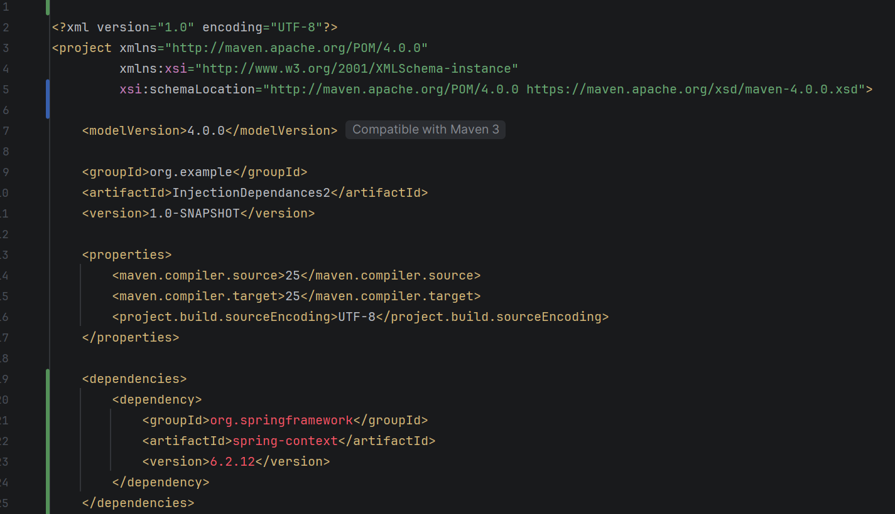

16. presentationSpringXml
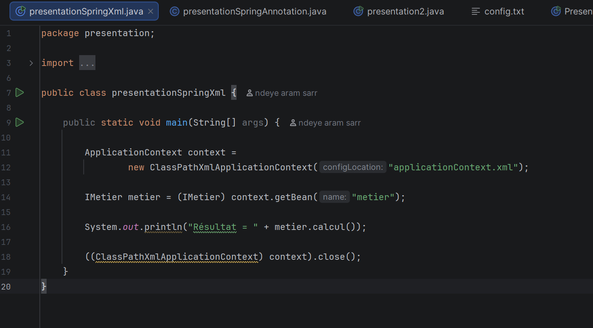

17. test de presentationSpringXml
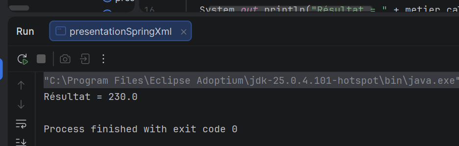
    
18. modification de metierImpl et DaoImpl avec component
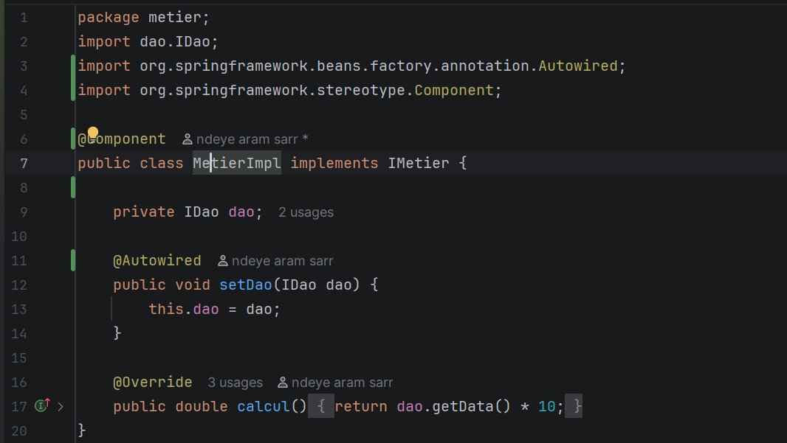
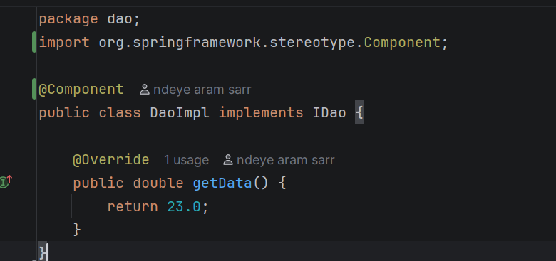

19. instanciation framework spring version annotations avec test
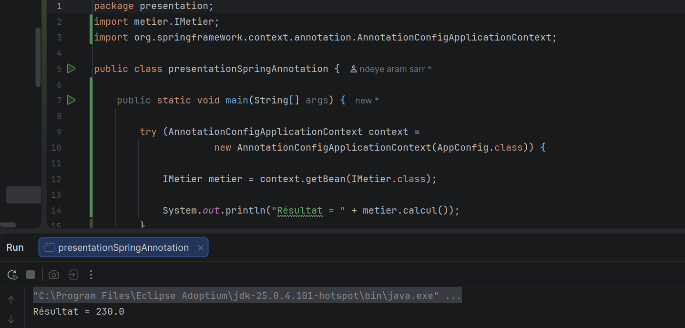

Conclusion : Ce projet m'a permis de comprendre le concept d'injection de dépendances en Java et son importance dans la réduction du couplage entre les classes. 
J'ai mis en œuvre quatre approches :
-L'injection de dépendances statique
-L'injection de dépendances dynamique à l'aide de la réflexion Java
-L'injection de dépendances avec Spring XML
-L'injection de dépendances avec les annotations Spring

Ce travail pratique a permis de découvrir comment l'injection de dépendances améliore la flexibilité, la maintenabilité et la réutilisabilité du code.
Il a également aidée à mieux comprendre les principes de la programmation orientée objet et les mécanismes du framework Spring.

